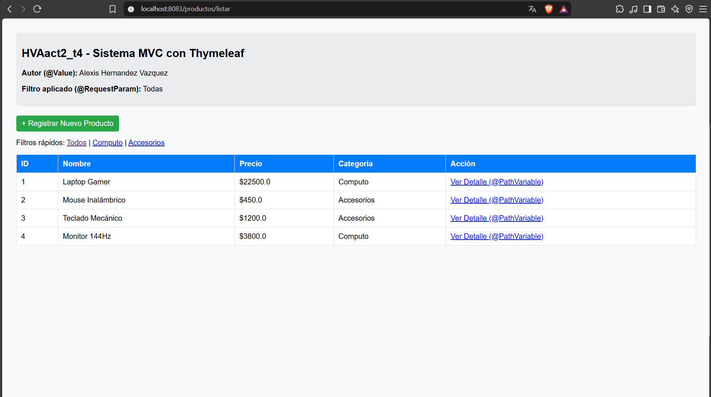
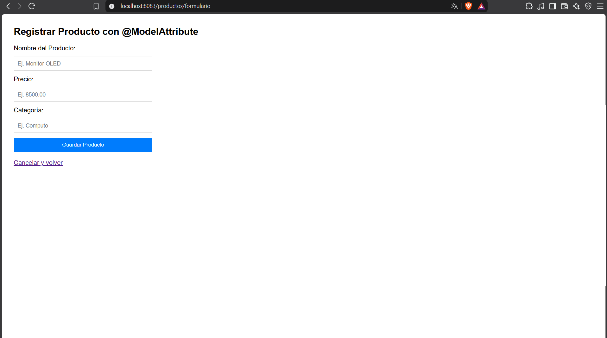
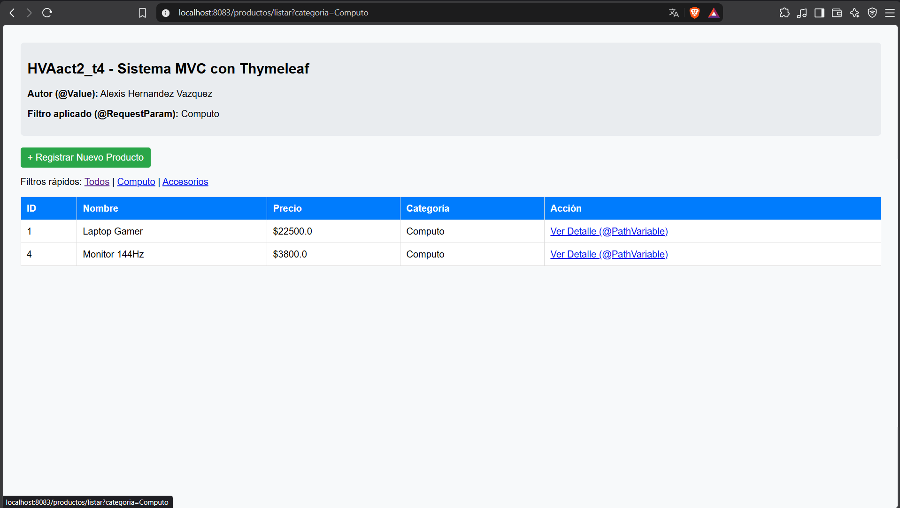
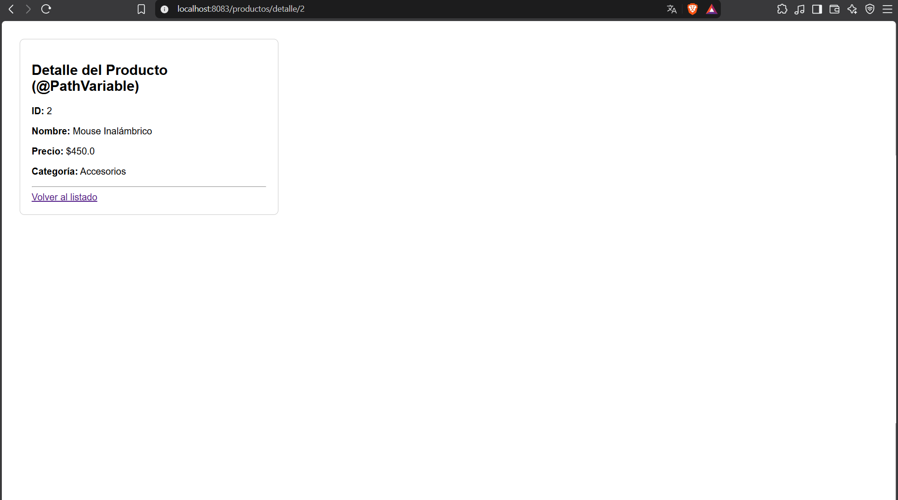
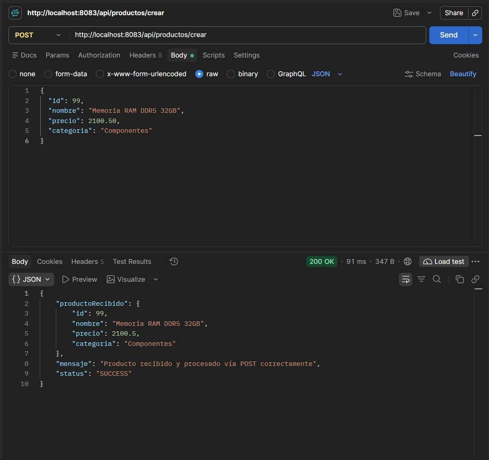

# HVAact2_t4 - Arquitectura MVC con Thymeleaf y Spring Boot

**Estudiante:** Alexis Hernández Vázquez  
**Materia:** Programación Web  
**Institución:** Instituto Tecnológico de Oaxaca  
**Puerto Asignado:** `8083`  
**Repositorio GitHub:** [https://github.com/alexhv21/HVAact2_t4](https://github.com/alexhv21/HVAact2_t4)

---

## Enlaces Rápidos de Producción (VPS)

* **Listado de Productos (MVC / Thymeleaf):** [http://204.48.17.197:8083/productos/listar](http://204.48.17.197:8083/productos/listar)
* **Formulario de Registro (MVC):** [http://204.48.17.197:8083/productos/formulario](http://204.48.17.197:8083/productos/formulario)
* **Endpoint REST POST:** `POST http://204.48.17.197:8083/api/productos/crear`
* **Instancia Actividad 1 (Puerto 8081):** [http://204.48.17.197:8081/api/info/identificacion](http://204.48.17.197:8081/api/info/identificacion)

---

## Descripción del Proyecto
Este proyecto implementa el patrón de arquitectura **Modelo-Vista-Controlador (MVC)** utilizando **Spring Boot 3** y el motor de plantillas **Thymeleaf** para renderizado del lado del servidor. Además, incorpora controladores REST para el manejo de transferencias JSON mediante clases DTO y el procesamiento de peticiones HTTP con diversas anotaciones (`@RequestParam`, `@PathVariable`, `@ModelAttribute`, `@RequestBody` y `@Value`).

---

## Tecnologías Utilizadas
* **Java 17 / 21**
* **Spring Boot 3.x**
* **Spring Web**
* **Thymeleaf** (`spring-boot-starter-thymeleaf`)
* **Maven Wrapper**
* **Postman / Bruno**
* **Servidor VPS Linux (Ubuntu)**

---

## Evidencias de Funcionamiento

### 1. Vista con Listado Dinámico (`th:each`) y Propiedad Externa (`@Value`)
La vista principal renderiza una tabla con la lista de productos almacenados en memoria y muestra los datos del proyecto y autor inyectados desde `application.properties` con `@Value`.

* **Ruta:** `http://localhost:8083/productos/listar`  


---

### 2. Formulario Web con Enlace de Datos (`@ModelAttribute`)
Formulario HTML para dar de alta nuevos productos vinculados al objeto `ProductoDTO`. Al procesar el envío, se agrega al catálogo y redirige al listado.

* **Ruta:** `http://localhost:8083/productos/formulario`  


---

### 3. Filtrado por Parámetros de Consulta (`@RequestParam`)
Filtrado dinámico de la lista de productos por la categoría enviada como query param en la URL.

* **Ruta:** `http://localhost:8083/productos/listar?categoria=Computo`  


---

### 4. Búsqueda y Detalle por Variable de Ruta (`@PathVariable`)
Consulta del detalle de un producto específico capturando su identificador único directamente en el segmento de la URL.

* **Ruta:** `http://localhost:8083/productos/detalle/2`  


---

### 5. Petición POST REST probada en Postman (`@RequestBody`)
Envío de datos estructurados en formato JSON a través del método HTTP POST utilizando el DTO para el procesamiento en el backend.

* **Endpoint:** `POST http://localhost:8083/api/productos/crear`  
* **Payload enviado:**
```json
{
  "id": 99,
  "nombre": "Memoria RAM DDR5 32GB",
  "precio": 2100.50,
  "categoria": "Componentes"
}
```



---

## Despliegue en el VPS

El proyecto fue empaquetado en un archivo binario `.jar` y desplegado en un servidor VPS independiente ejecutándose con `nohup` en el puerto `8083`, manteniendo intacta la instancia de la Actividad 1 en el puerto `8081`.

* **URL en producción:** [http://204.48.17.197:8083/productos/listar](http://204.48.17.197:8083/productos/listar)
* **Comando de ejecución en VPS:**

```bash
nohup java -jar ~/actividad2/hva-act2.jar > ~/actividad2/hva-act2.log 2>&1 &
```